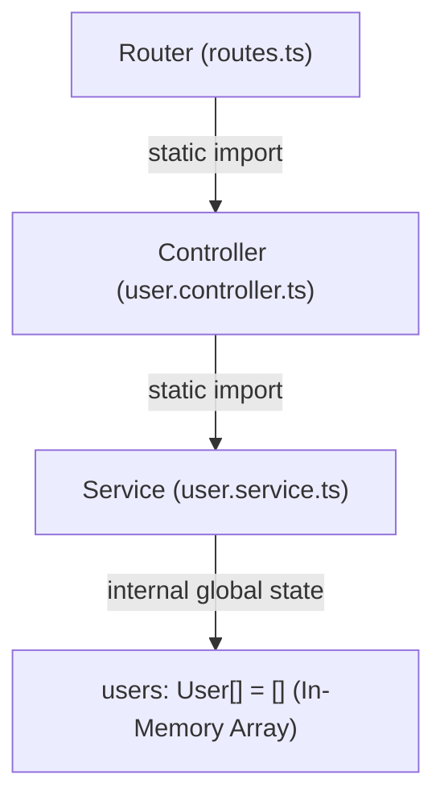
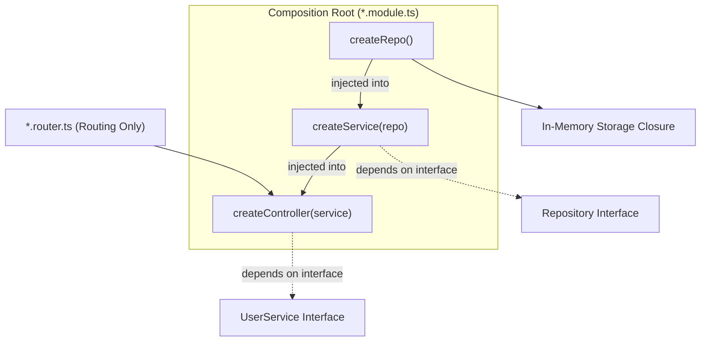

# Architecture Evolution: From Tightly Coupled to Clean Dependency Injection in TypeScript

> A step-by-step engineering retrospective detailing how an Express & TypeScript API evolved from a tightly coupled monolith into a modular, decoupled, and highly testable architecture following the **Single Responsibility Principle (SRP)** and **Dependency Injection (DI)**.

---

## 📑 Table of Contents

1. [Executive Summary](#-executive-summary)
2. [High-Level Architecture: Before vs. After](#-high-level-architecture-before-vs-after)
3. [The Evolutionary Journey](#-the-evolutionary-journey)
    - [Phase 1: The Monolithic Service (Tightly Coupled)](#phase-1-the-monolithic-service-tightly-coupled)
    - [Phase 2: Introducing the Concrete Repository Pattern](#phase-2-introducing-the-concrete-repository-pattern)
    - [Phase 3: Scaling with Generic Repositories (`Repository<T>`)](#phase-3-scaling-with-generic-repositories-repositoryt)
    - [Phase 4: Inversion of Control & Functional Dependency Injection](#phase-4-inversion-of-control--functional-dependency-injection)
    - [Phase 5: Single Responsibility & Dedicated Composition Roots (`*.module.ts`)](#phase-5-single-responsibility--dedicated-composition-roots-modulets)
4. [Architecture Comparison Matrix](#-architecture-comparison-matrix)
5. [Current Project Structure](#-current-project-structure)
6. [Key Engineering Takeaways](#-key-engineering-takeaways)

---

## 📌 Executive Summary

Modern backends must balance **simplicity**, **type safety**, and **maintainability**. In early prototypes, logic, data storage, and HTTP routing are often bundled together. While quick to build, this creates severe friction:

- **Zero testability**: Cannot test business logic without mutating shared storage.
- **High coupling**: Switching from in-memory arrays to a database requires rewriting services and controllers.
- **Code duplication**: Every new entity duplicates boilerplate queries.

This document traces the systematic refactoring of the `user` and `product` domains in this project, illustrating how applying SOLID principles and functional TypeScript patterns transformed the codebase into an enterprise-ready architecture.

---

## 🔄 High-Level Architecture: Before vs. After

### Before (Tightly Coupled Monolith)

Each layer directly instantiated and managed its own lower-level dependencies via global state:



### After (Clean Decoupled Architecture with Composition Root)

Dependencies flow downward via explicit contracts (interfaces) and are assembled externally:



---

## 🚀 The Evolutionary Journey

### Phase 1: The Monolithic Service (Tightly Coupled)

#### The Initial Implementation

In the beginning, `user.service.ts` was responsible for **both** data persistence and business logic:

```typescript
// ❌ user.service.ts (Before)
const users: User[] = []; // Global in-memory state

export async function getUser(id: string) {
    return users.find((u) => u.id === id);
}

export async function createUser(input: CreateUserInput) {
    const newUser = { ...input, id: crypto.randomUUID(), createdAt: new Date() };
    users.push(newUser); // Direct persistence manipulation!
    return newUser;
}
```

#### The Challenges

1. **Violation of SRP**: The service handled ID generation, timestamping, _and_ array mutations.
2. **Untestable**: Every unit test mutated the same module-level `users` array, causing test pollution.
3. **Database Lock-in**: Replacing the array with PostgreSQL or Prisma would require modifying the service's core business functions.

---

### Phase 2: Introducing the Concrete Repository Pattern

#### The Solution

We extracted storage operations into a dedicated **Repository** layer implementing a contract:

```typescript
// 1. shared/repository.ts
export interface UserRepository {
    findAll(): User[];
    findById(id: string): User | undefined;
    create(input: User): User;
    update(id: string, input: Partial<User>): User | undefined;
    delete(id: string): boolean;
}

// 2. domain/user/user.repository.ts
export const createUserRepo = (): UserRepository => {
    const users: User[] = [];
    return {
        findAll: () => users,
        findById: (id) => users.find((u) => u.id === id),
        create: (input) => {
            users.push(input);
            return input;
        },
        update: (id, input) => {
            /* update in array */
        },
        delete: (id) => {
            /* splice from array */
        },
    };
};
```

#### What Was Solved:

- Persistence logic was encapsulated inside `createUserRepo()`.
- The service no longer touched array methods (`.push`, `.splice`, `.findIndex`).

#### The Next Challenge:

When we created the `Product` domain, we had to redefine the entire `ProductRepository` interface from scratch. The code was clean, but we were duplicating identical method signatures for every domain model.

---

### Phase 3: Scaling with Generic Repositories (`Repository<T>`)

#### The Solution

We created a reusable generic contract: `Repository<T>`. Entity-specific repositories extend this base to inherit common CRUD operations while adding domain-specific queries.

```typescript
// src/shared/repository.ts
export interface Repository<T> {
    findAll(): T[];
    findById(id: string): T | undefined;
    create(input: T): T;
    update(id: string, input: Partial<T>): T | undefined;
    delete(id: string): boolean;
}

// User-specific queries:
export interface UserRepository extends Repository<User> {
    findByEmail(email: string): User | undefined;
}

// Product-specific queries:
export interface ProductRepository extends Repository<Product> {
    findByCategory(category: string): Product[];
}
```

#### What Was Solved:

- **Zero code duplication**: Core CRUD signatures are defined once.
- **Flexible extension**: Entities add bespoke queries (`findByEmail`, `findByCategory`) without polluting the generic base.

---

### Phase 4: Inversion of Control & Functional Dependency Injection

#### The Challenge

Even though we had clean interfaces, the service and controller still **hardcoded** their dependency instantiations:

```typescript
// ❌ Still tightly coupled:
const userRepo = createUserRepo(); // Hardcoded inside service file!
```

#### The Solution

We refactored all services and controllers into **pure factory functions** that receive their dependencies as arguments:

```typescript
// src/domain/user/user.service.ts
export interface UserService {
    getAllUsers(): User[];
    getUserById(id: string): User | undefined;
    createUser(input: CreateUserInput): User;
    updateUser(userId: string, input: UpdateUserInput): User | undefined;
    deleteUser(id: string): boolean;
}

export const createUserService = (userRepo: UserRepository): UserService => {
    return {
        getAllUsers: () => userRepo.findAll(),
        getUserById: (id) => userRepo.findById(id),
        createUser: (input) => {
            const newUser: User = {
                ...input,
                id: crypto.randomUUID(),
                createdAt: new Date(),
            };
            return userRepo.create(newUser);
        },
        updateUser: (userId, input) => userRepo.update(userId, input),
        deleteUser: (id) => userRepo.delete(id),
    };
};
```

And similarly for the controller:

```typescript
// src/domain/user/user.controller.ts
export const createUserController = (userService: UserService) => {
    // Handlers use injected userService
    return { getUser, getAllUsers, createUser, updateUser, deleteUser };
};
```

#### What Was Solved:

- **100% Mockable**: In unit tests, pass a mock `UserRepository` (or mock `UserService`) with zero dependencies on HTTP servers or real storage.
- **Inversion of Control (IoC)**: High-level modules no longer depend on low-level instantiations; both depend on abstractions.

---

### Phase 5: Single Responsibility & Dedicated Composition Roots (`*.module.ts`)

#### The Challenge

After applying DI, where should the dependencies actually be instantiated and wired together? At first, the router was doing the wiring:

```typescript
// ❌ Problem: The router had two jobs (Routing + Dependency Assembly)
const userRepo = createUserRepo();
const userService = createUserService(userRepo);
const userController = createUserController(userService);

router.get("/:userId", userController.getUser);
```

#### The Solution

We separated the **Routing** from the **Wiring** by creating dedicated domain modules (`user.module.ts` and `product.module.ts`):

```typescript
// 1. src/domain/user/user.module.ts (The Composition Root)
import { createUserRepo } from "./user.repository";
import { createUserService } from "./user.service";
import { createUserController } from "./user.controller";

const userRepo = createUserRepo();
const userService = createUserService(userRepo);
const userController = createUserController(userService);

export default userController;
```

```typescript
// 2. src/domain/user/user.router.ts (Pure Routing)
import express from "express";
import userController from "./user.module";

const router = express.Router();

router
    .route("/:userId")
    .get(userController.getUser)
    .patch(userController.updateUser)
    .delete(userController.deleteUser);

router.route("/").get(userController.getAllUsers).post(userController.createUser);

export default router;
```

```typescript
// 3. src/router/index.ts (Root Application Router)
import { Router } from "express";
import userRoutes from "../domain/user/user.router";
import productRoutes from "../domain/product/product.router";

const router = Router();
router.use("/user", userRoutes);
router.use("/product", productRoutes);

export default router;
```

---

## 📊 Architecture Comparison Matrix

| Quality Attribute          | Initial State (Phase 1)        | Intermediate State (Phase 2-3)  | Final State (Phase 5)                                      |
| -------------------------- | ------------------------------ | ------------------------------- | ---------------------------------------------------------- |
| **Coupling**               | High (hardcoded globals)       | Moderate (layer separation)     | **Loose (pure interface injection)**                       |
| **Testability**            | Hard (mutates global state)    | Moderate (requires reset hooks) | **Trivial (pass mock implementations)**                    |
| **Separation of Concerns** | Mixed (persistence in service) | Separated (service vs repo)     | **Strict SRP (Module, Router, Controller, Service, Repo)** |
| **Generic Reusability**    | None                           | Entity-specific                 | **High (`Repository<T>` shared across domains)**           |
| **Extensibility**          | Rewrites required              | Repositories extendable         | **Plug-and-play modules**                                  |

---

## 📂 Current Project Structure

```text
tsp-1/
├── package.json
├── tsconfig.json
└── src/
    ├── app.ts                          # Express server setup & middleware
    ├── server.ts                       # HTTP server entry point
    │
    ├── helpers/
    │   └── api/
    │       └── apiResponse.types.ts    # Generic ApiResponse<T> formatter
    │
    ├── shared/
    │   └── repository.ts               # Generic base Repository<T> & domain interfaces
    │
    ├── router/
    │   └── index.ts                    # Root router mounting /user and /product
    │
    └── domain/
        ├── user/                       # User Domain
        │   ├── user.types.ts           # Domain models, CreateUserInput, UpdateUserInput
        │   ├── user.repository.ts      # In-memory implementation with findByEmail
        │   ├── user.service.ts         # Business logic with injected UserRepository
        │   ├── user.controller.ts      # HTTP handlers with injected UserService
        │   ├── user.module.ts          # Composition Root: Wires User DI chain
        │   └── user.router.ts          # Pure Express route definitions
        │
        └── product/                    # Product Domain
            ├── product.types.ts        # Domain models, CreateProductInput, UpdateProductInput
            ├── product.repository.ts   # In-memory implementation with findByCategory
            ├── product.service.ts      # Business logic with injected ProductRepository
            ├── product.controller.ts   # HTTP handlers with injected ProductService
            ├── product.module.ts       # Composition Root: Wires Product DI chain
            └── product.router.ts       # Pure Express route definitions
```

---

## 💡 Key Engineering Takeaways

1. **Interfaces as Contracts**: Services and controllers depend on TypeScript `interface` definitions, never concrete implementations.
2. **Functional Closures over Classes**: Achieved full encapsulation and private state without `this` binding issues or heavy class hierarchies.
3. **Single Responsibility at Every Level**:
    - `repository`: Read/write storage.
    - `service`: Validation & domain rules.
    - `controller`: Status codes & HTTP serialization.
    - `router`: URL path mapping.
    - `module`: Dependency assembly.
4. **Compile-Time Safety**: Strong utility types (`Omit`, `Partial`) prevent mutating immutable fields (like `id` and `createdAt`) before runtime.
